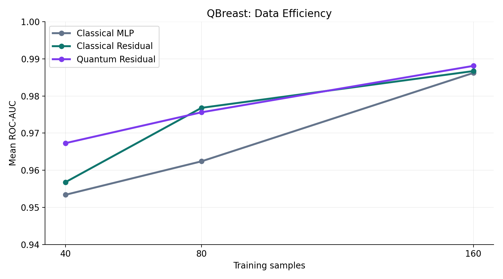
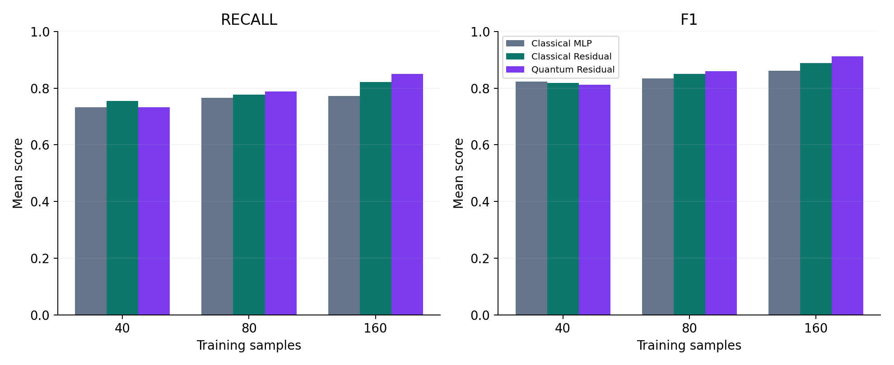

# QBreast — Quantum Machine Learning for Breast Cancer Classification

**Qiskit Fall Fest 2026 | QML for Healthcare** · [Research notebooks](testing/) · [Results report](RESULTS.md)

> **Research question:** Can quantum feature maps, trainable quantum circuits, or hybrid quantum–classical networks offer useful predictive trade-offs over credible classical baselines when labeled diagnostic data are scarce?

QBreast is a multi-stage, **exploratory** investigation of quantum machine learning (QML) using the Wisconsin Diagnostic Breast Cancer dataset (569 samples, 30 numerical features). **Malignant is the positive class (1)**. We evaluate ROC-AUC, malignant recall (sensitivity), precision, F1, specificity, false negatives, and runtime. This is **not a medical device** and has no external clinical validation. This is in line with Breast Cancer Awareness month.

## At a glance: what we built

The project started with classical classifiers, explored multiple quantum kernel methods, then trained variational quantum neural networks (QNNs), and finally tested whether a quantum residual branch adds value to a classical predictor. We retained negative findings and computational costs, not only favorable comparisons.

| Research stage | Experiment | Main observation | Source notebook |
|---|---|---|---|
| Classical foundation | Classical SVM and other baselines; limited-data subsets | Strong classical controls are necessary for fair evaluation | [Classical baseline](testing/phase1_classical_baseline.ipynb) |
| Phase 1 | Fixed quantum-kernel SVM and threshold adjustment | High ranking performance in some settings, but threshold-sensitive malignant recall | [Quantum kernel](testing/phase1_quantum_kernel.ipynb) |
| Phase 2 | Kernel geometry, trainable kernels and feature-map alignment | Better kernel alignment did not reliably translate into better classification | [Phases 2–5](testing/phases2_5.ipynb) |
| Phase 3 | Feature selection and quantum/classical kernel comparisons | Feature subsets sometimes differed, with mixed downstream gains | [Phases 2–5](testing/phases2_5.ipynb) |
| Phase 4 | Input-noise robustness | No consistent quantum robustness advantage under tested perturbations | [Phases 2–5](testing/phases2_5.ipynb) |
| Phase 5 | Mixtures of feature-map kernels and recall-target calibration | Some small-data improvements, but results depend on sample size and operating point | [Phases 2–5](testing/phases2_5.ipynb) |
| Phase 6 | Hybrid QNN vs MLP, depth/entanglement ablations, nested optimization | Two-layer entangled QNN-C was competitive in some small-data comparisons but much slower | [QNN experiments](testing/phase6_quantum_vs_mlp.ipynb) |
| Phase 7 | Data re-uploading QNN vs original QNN-C | Re-uploading did not consistently improve performance at matched parameter count | [Re-uploading](testing/phase7_data_reuploading_qnn.ipynb) |
| Phase 8 | Classical MLP, classical residual, quantum residual | Small exploratory improvements for quantum residual at 160 training samples | [Residual learning](testing/phase8_quantum_classical_residual.ipynb) |

These stages use **different validation protocols**; their scores must not be combined into one universal leaderboard. Full research notebooks remain in [`testing/`](testing/).

## Featured result: quantum–classical residual learning (Phase 8.10)

The main controlled comparison uses a four-feature classical MLP, a similar-capacity classical residual branch, and a **four-qubit, two-layer quantum residual branch**. The residual is added to the classical logit with fixed coefficient 0.5. The classical residual is an important capacity control: an improvement over the base MLP alone would not establish a quantum-specific contribution.

**160 training samples · three subset seeds · stratified three-fold CV · 30 epochs · Adam, LR 0.03**

| Model | Parameters | Mean ROC-AUC | Mean malignant recall | Mean F1 | Mean specificity |
|---|---:|---:|---:|---:|---:|
| Classical MLP | 25 | 0.9862 | 0.7722 | 0.8610 | 0.9966 |
| Classical residual | 44 | 0.9867 | 0.8222 | 0.8882 | 0.9901 |
| **Quantum residual** | **46** | **0.9881** | **0.8500** | **0.9125** | **0.9933** |

Compared with the classical residual, the quantum residual had a **+0.0013 paired mean ROC-AUC difference**, **+0.0278 recall**, and **+0.0242 F1**. The paired F1-difference standard deviation was **0.0822**. These small exploratory gains are **not evidence of statistically established quantum advantage**. Quantum training was orders of magnitude slower on a CPU simulator.





For paired differences, runtime comparisons, methodology, and limitations, see **[RESULTS.md](RESULTS.md)**.

## How the quantum residual works

1. Standardize the 30 input measurements, reduce to **four PCA features**, then scale angles to **[0, π]**; fit all preprocessing within the training fold.
2. Classical base: `Linear(4,4) → Tanh → Linear(4,1)`.
3. Quantum branch: four RY-encoded qubits; two layers of trainable RY/RZ gates and CNOT entanglers; four Pauli-Z expectation values; linear output.
4. Combined logit: `classical_base(x) + 0.5 × quantum_branch(x)`; optimize with binary cross-entropy and Adam.
5. Compare against both a standalone MLP and an extra **classical** residual branch.

All quantum circuits in this project were evaluated on classical simulators, not quantum hardware.

## Repository guide

```text
README.md                         Project overview, all phases, main findings
RESULTS.md                        Detailed Phase 8.10 figures and results
requirements.txt                  Python dependencies
run_experiment.py                 Small Phase 8-only reproduction demo
src/                              Phase 8 reusable data/model/metrics modules
results/                          Extracted Phase 8.10 summary and figures
tests/                            Lightweight correctness checks
testing/                          Original experiments for Phases 1–8
  results/
    qbreast_limited_data.zip      Saved subset indices / earlier data artifacts
    phase810_results (1).zip      Original Phase 8.10 results archive
    qbreast_person_a.zip          Earlier experimental artifacts
```

**Important:** `run_experiment.py` is **only a small Phase 8 residual-model demonstration**. It does **not** rerun the entire QBreast project. For the other phases, open the linked research notebooks in `testing/`.

## Quick start (small Phase 8 demonstration)

From the repository root:

```bash
python -m pip install -r requirements.txt
python -m pytest -q tests/
python run_experiment.py --indices limited_data/data_n40_seed42.npz --samples 40
```

The subset loader first checks `limited_data/data_n40_seed42.npz` and, if missing, attempts to read the same NPZ from `testing/results/qbreast_limited_data.zip`. **The ZIP member name has not been independently verified**; if the command reports a missing subset, inspect the ZIP (`python -m zipfile -l testing/results/qbreast_limited_data.zip`) and use the matching original NPZ. Do not regenerate the research split and treat it as equivalent. This runner performs three-fold CV on **one** 40-sample subset, and its results are not the complete reported 40/80/160-sample multi-seed benchmark.

**Verification status:** All automated tests passed successfully (2/2), including data preprocessing, quantum model execution, and gradient verification. All eight research phases were executed, and their experimental results are preserved in the GitHub notebooks. The reported findings have been checked against the saved notebook outputs.

**Classical baseline note:** The `NaN` values in the *Quantum Results Integration Template* are intentional placeholders for results subsequently generated in the dedicated [quantum kernel notebook](testing/phase1_quantum_kernel.ipynb). They do not indicate failed experiments.

## Results and scientific interpretation

- **Quantum kernels (Phases 1–5):** several feature maps, alignment diagnostics, feature selection methods, noise experiments, and kernel mixtures were studied. Performance was competitive in selected small-data settings but not uniformly better than strong classical kernels.
- **Hybrid QNN (Phase 6):** QNN-C (two entangled variational layers) performed better than shallower quantum variants in the reported architecture comparison, but did not consistently beat an MLP across training sizes and incurred substantial simulation cost.
- **Data re-uploading (Phase 7):** repeated encoding with matched parameter count reduced mean ROC-AUC relative to QNN-C at all three tested sizes under fixed training settings.
- **Residual learning (Phase 8):** a quantum correction to a classical predictor showed small improvements over a similarly sized classical residual at 160 samples, but mixed results at 40 and 80 samples.

**Limitations:** training subsets overlap, the dataset was repeatedly explored, and there is no external patient cohort. Results from different phases cannot be ranked directly; threshold-based sensitivity is not assessed at a matched specificity; the quantum simulation is much slower; no quantum speedup or clinical effectiveness is claimed.

## Research context and attribution

The project was informed by a Scopus AI literature survey on quantum kernel learning for breast cancer classification (2023–2026), including topics such as trainable feature maps, kernel alignment, dimensionality reduction, data re-uploading, and hybrid quantum–classical classifiers. The survey is a secondary research guide; individual claims should be checked against original publications. Our experimental claims come from our own notebook outputs, not from the survey.

- **Dataset:** Wisconsin Diagnostic Breast Cancer dataset, accessed through `sklearn.datasets.load_breast_cancer` (original dataset by Wolberg, Street, and Mangasarian).
- **Tools:** PennyLane, PyTorch, scikit-learn, NumPy, pandas.
- **Our plan:** strong classical baselines, purposeful quantum integration, matched data splits, clinically meaningful metrics, and honest computational trade-offs.

**Research prototype only — not for clinical decision-making.**
