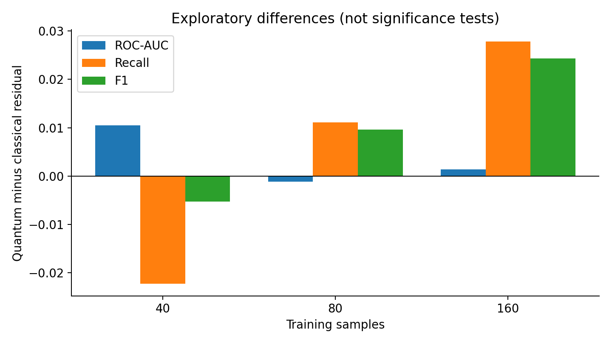
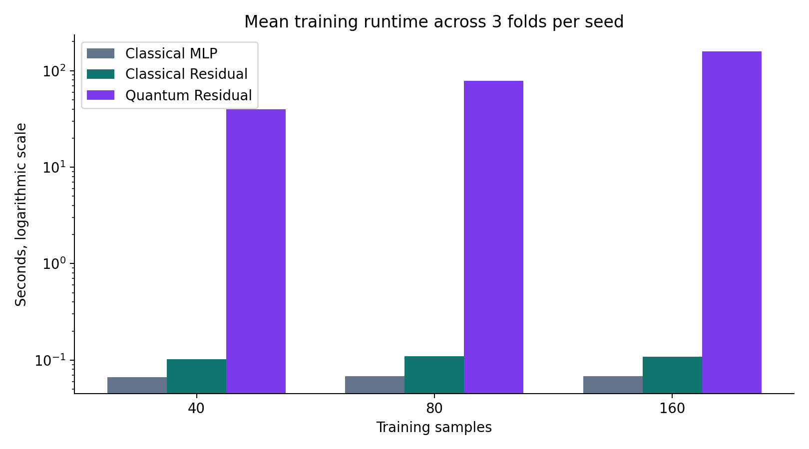

# QBreast — Research Results

**Primary quantitative showcase: Phase 8.10.** The source experiment is in `testing/phase8_quantum_classical_residual.ipynb`; its original result archive is in `testing/results/`. The CSV here is a convenience summary based on the recorded metrics.

## Residual-network comparison

| Samples | Model | ROC-AUC | Malignant recall | F1 | Specificity |
|---:|---|---:|---:|---:|---:|
| 40 | Classical MLP | 0.9534 | 0.7333 | 0.8228 | 0.9861 |
| 40 | Classical residual | 0.9568 | 0.7556 | 0.8182 | 0.9599 |
| 40 | Quantum residual | **0.9673** | 0.7333 | 0.8129 | 0.9738 |
| 80 | Classical MLP | 0.9624 | 0.7667 | 0.8352 | 0.9734 |
| 80 | Classical residual | **0.9768** | 0.7778 | 0.8503 | 0.9796 |
| 80 | Quantum residual | 0.9756 | **0.7889** | **0.8599** | 0.9796 |
| 160 | Classical MLP | 0.9862 | 0.7722 | 0.8610 | **0.9966** |
| 160 | Classical residual | 0.9867 | 0.8222 | 0.8882 | 0.9901 |
| 160 | Quantum residual | **0.9881** | **0.8500** | **0.9125** | 0.9933 |

At 160 samples, the quantum residual improves mean ROC-AUC by approximately 0.0013, malignant recall by 2.78 percentage points, and F1 by 0.0242 relative to the similarly sized classical residual. The paired F1 difference has standard deviation 0.0822 across the nine paired folds, and the subsets overlap; the evidence does not establish statistical superiority.

## Runtime

Quantum simulation was orders of magnitude slower than classical neural-network training. The chart uses a logarithmic axis. Times are mean sums over three folds per subset seed, not single-fit timings or hardware quantum runtimes.

## Other research directions

- **Phases 1–5:** Classical and quantum kernels, kernel alignment, trainable kernels, feature selection, robustness and kernel mixtures. Gains were mixed and strong classical controls often matched or exceeded quantum models.
- **Phase 6:** A trainable two-layer hybrid QNN was competitive on some small-data metrics, but substantially slower than a small classical MLP.
- **Phase 7:** Data re-uploading did not consistently improve QNN performance.
- **Phase 8:** A quantum correction branch produced small improvements in some settings relative to a classical capacity control.

These phases were conducted under different evaluation procedures. Their metrics must **not** be treated as a single head-to-head leaderboard. Consult the original notebooks for details.

## Validity and limitations

The dataset is a small tabular benchmark, not a prospective clinical cohort. Training subsets and validation folds overlap across experiments; multiple model comparisons introduce selection bias. The reported validation scores are exploratory and do not demonstrate a general quantum advantage, clinical utility, or hardware speedup. No independent external validation has been performed. The original test split must remain excluded from training and tuning.
